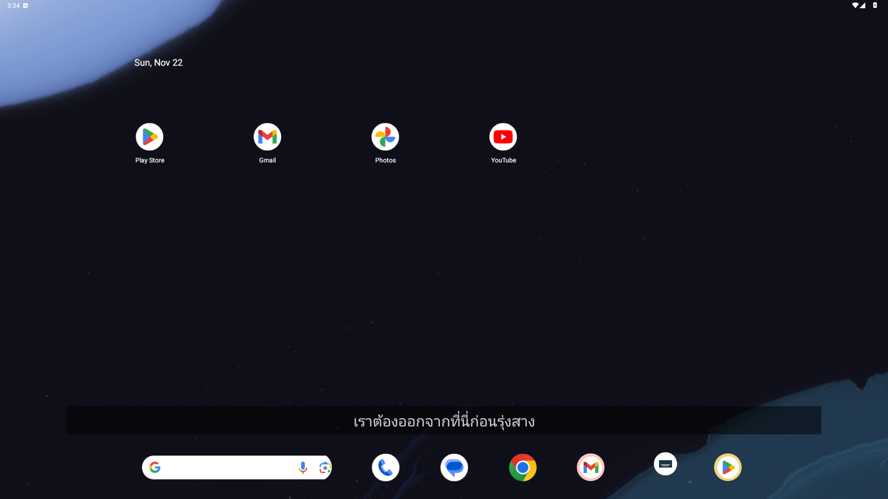
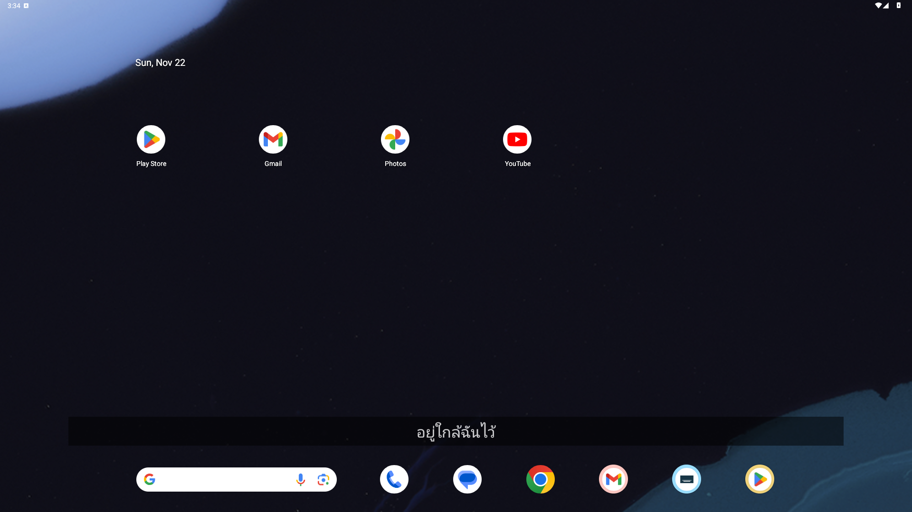

# Draft PR: Add PS5 Thai subtitle overlay and Mac speech pipeline

PS5 gameplay remains on direct HDMI while a Mac listens to TV dialogue and publishes
Thai captions to a user-started Android overlay. This proof of concept adds the M0
feasibility APK first, an authenticated LAN bridge, local Whisper/Ollama translation,
and a browser fallback when a TV blocks HDMI overlays.

## Changes

- Native Kotlin foreground service with transparent non-interactive Thai caption window,
  permission/start/stop/test/hide controls and text/opacity/safe-area presets.
- Token-authenticated, bounded LAN caption endpoint with deduplication and monotonic expiry.
- Python microphone/VAD pipeline, bounded queue, real ASR/translation adapters, context echo
  guard, demo fixtures, latency metrics, retries and packaged localhost viewer.
- Gradle wrapper, uv lockfile, CI, protocol schema, setup and physical acceptance worksheet.

## Validation

Android APK/build/lint pass (4 JUnit tests; 0 lint errors / 6 localization warnings).
Python: 21 tests, Ruff, mypy and wheel build pass. Fresh generic Android 16 emulator
verified Thai rendering over home, auth, duplicates, expiry, hide and listener shutdown.
Real whisper.cpp + Gemma 3 4B processed synthesized audio and published Thai to emulator.
Mac microphone startup and browser preview verified. See TEST_REPORT.md for exact scope.




## Required before hardware acceptance

BRAVIA 9 HDMI is **NOT TESTED**. Test local Thai text over PS5 first, then direct DualSense,
Game Mode/HDR/4K/VRR, standby/resume and real game audio quality/latency. If HDMI fails,
stop TV rollout and use Mac fallback. HTTP is trusted-LAN-only and is not encrypted.

## Publication status

Prepared locally on `feat/ps5-thai-subtitles`; no remote was configured, so no hosted PR
was opened and no CI run is claimed. After configuring the intended repository:

```sh
git push -u origin main
git push -u origin feat/ps5-thai-subtitles
gh pr create --draft --base main --head feat/ps5-thai-subtitles --title "Add PS5 Thai subtitle overlay and Mac speech pipeline" --body-file PR_DRAFT.md
```

No merge or deployment is part of this change.

## Follow-up: optional Remote Play OCR

Adds window-only ScreenCaptureKit capture and English Apple Vision OCR, configurable
subtitle crop, stability filtering, duplicate suppression, expiry renewal and stale-result
rejection. No microphone or Whisper dependency in OCR mode. Native helper builds on first
run and is included in the wheel as Swift source. 27 Python tests, native OCR/capture
fixture checks and synthetic OCR-to-TV smoke pass. Actual Remote Play game-session and
controller coexistence still require user connection and hardware verification.

Follow-up model choice: user-requested OpenThai default with `--model openthai`,
`--model gemma` and full model IDs; `models` reports presets/effective default.
CLI/environment priority tested; 33 Python tests pass. Switching takes effect on restart.

Follow-up v0.3.0: optional Remote Play application-audio input via ScreenCaptureKit,
without microphone/loopback driver. App inclusion filtering, checked 16kHz mono PCM,
bounded VAD buffering, privacy-safe signal telemetry and helper lifecycle cleanup.
Actual Remote Play nonzero audio verified; 40 Python tests. Model presets apply to all
three input modes. Audio/translation quality remains a separate acceptance check.

Speech filtering 0.3.1: strict WebRTC speech gate for Remote Play audio plus sound/lyric cue removal before translation. 48 Python tests pass; mypy passes. Includes loud non-speech rejection with a controlled detector, actual detector silence rejection, and cue preservation/removal tests. Real-game music/speech discrimination is not yet validated.

0.3.2 latency tuning: app audio collection cap 4s → 2s; silence finalization 500ms → 300ms; stage timings added without dialogue logs. Strict speech filtering and OpenThai preserved. 49 tests and mypy pass. Shorter chunks trade sentence context for earlier results; total live latency still needs observation.

0.3.3: optional --ocr-chat adds independently stabilized bottom-right OCR alongside the subtitle crop. Combined bounded overlay; no simultaneous audio. 50 tests and mypy pass. Live capture returned subtitle characters but no chat; real chat-region alignment remains unverified.

0.3.4 adds --ocr-phone and --ocr-phone-region. Phone crop defaults to 0.35,0.23,0.27,0.59.
A configurable center crop with >=60 recognized characters and >=10 words takes priority
while the phone is open; otherwise normal subtitle/chat regions are processed. This is a
text-density heuristic, not a visual phone detector: short messages may be missed and other
text-heavy center panels can trigger it. It does not scroll or operate the phone for the user.
51 tests pass including return to subtitles after phone text disappears. Live session uses
subtitle 0.15,0.70,0.60,0.25; chat 0.79,0.77,0.20,0.21; phone 0.35,0.20,0.27,0.65,
based on inspection of the actual Remote Play window. Audio capture is stopped for OCR.

0.4.0 hybrid: single native window/audio stream, OCR priority with speech fallback,
independent chat/phone regions, bounded two-job processing and one publisher. 58 Python
tests pass plus native compilation. Live hybrid received video OCR and audio frames
concurrently and sent subtitle/chat translations to TV. Live speech fallback, accuracy
and long-run stability remain unverified. See docs/HYBRID.md for plan and limitations.

0.5.0 adds `leonida-tv-bridge`: forwards new captions from Leonida Mac's enabled LAN web viewer to Mac preview/optional existing TV overlay, with no library extraction or AI calls. 62 tests and mypy pass. Actual SSE connection verified; new gameplay captions and TV delivery still require verification. See docs/LEONIDA.md.
