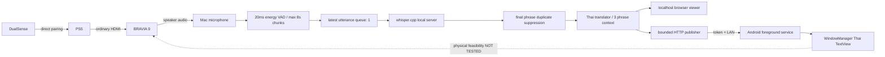

# Architecture

Audio never travels from PS5 electronically to Mac. No capture hardware/Remote Play,
OCR, controller interception or HDMI alteration. The OS may block overlay composition
on HDMI or protected surfaces. Text is drawn only inside the caption region.

The pipeline timestamps the last voiced input frame, then records elapsed time after
publish acknowledgement. Includes silence detection, queue wait, ASR, translation and
transport; excludes physical panel render delay. Demo timings are not microphone data.
Target median ≤3 seconds is aspirational and must be measured with actual game audio.
